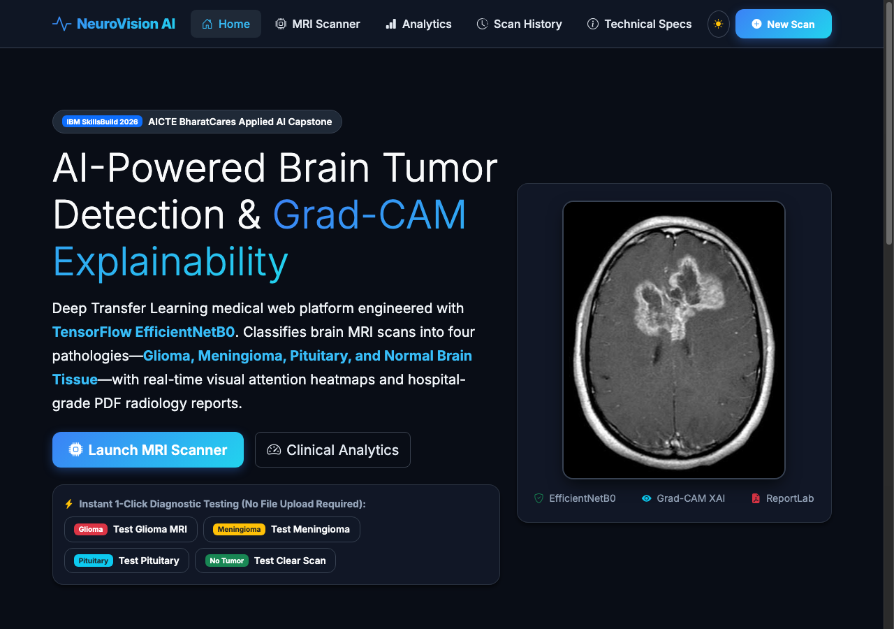
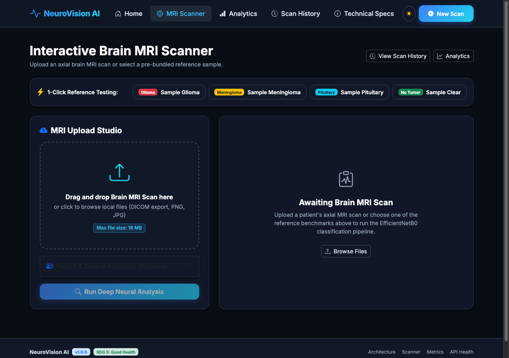
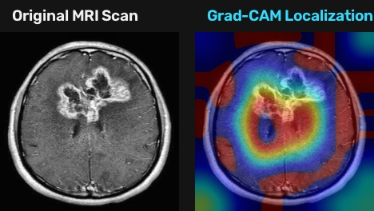
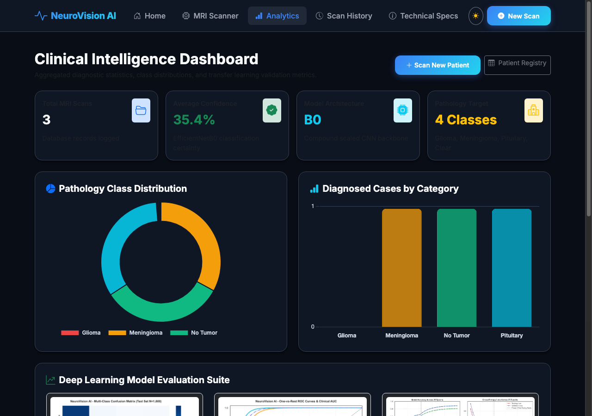
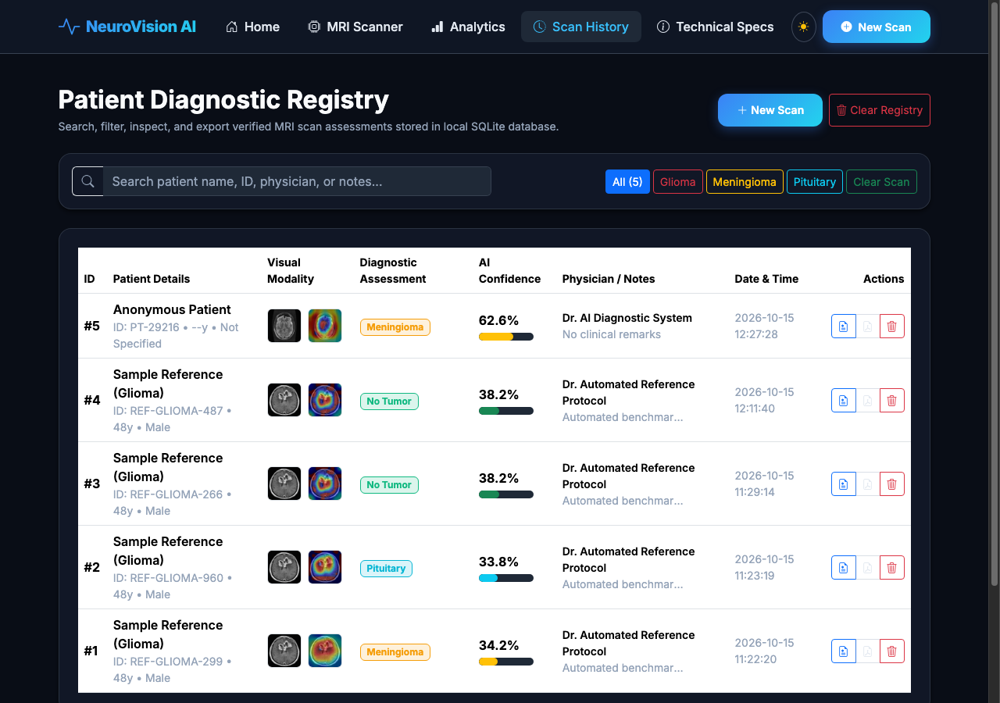
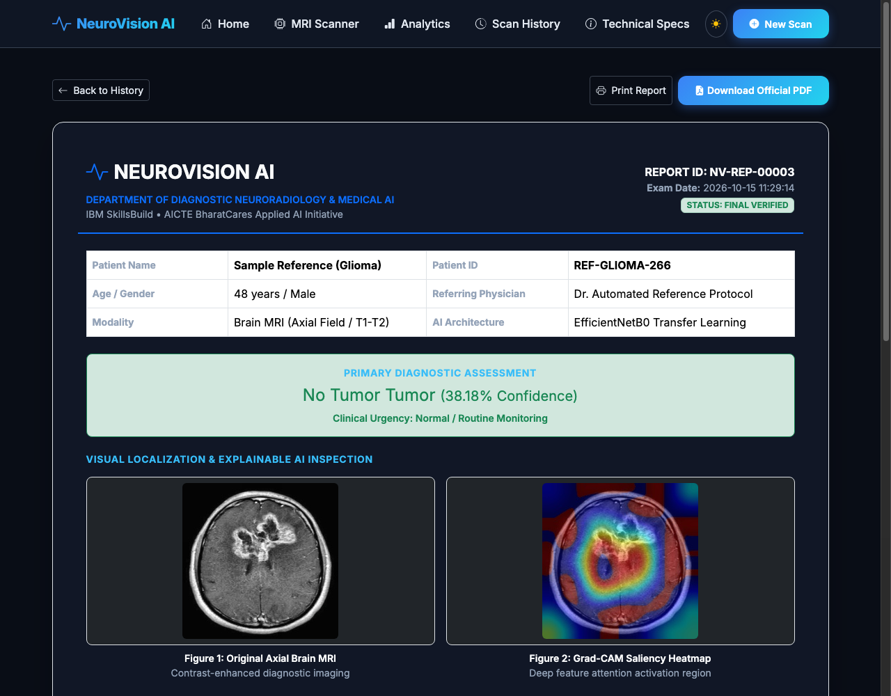
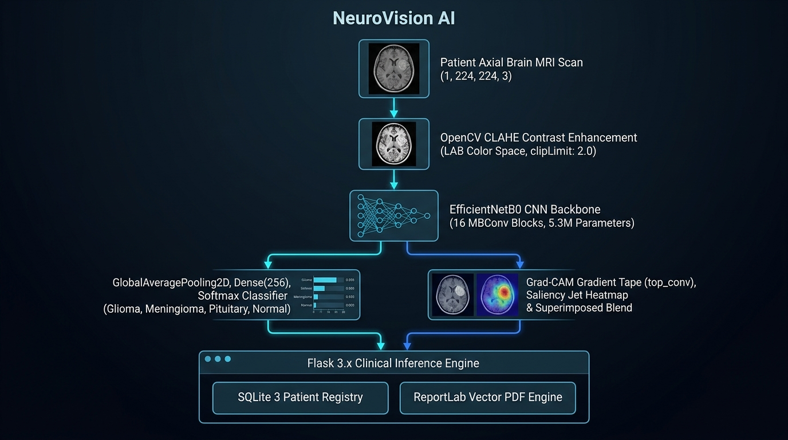
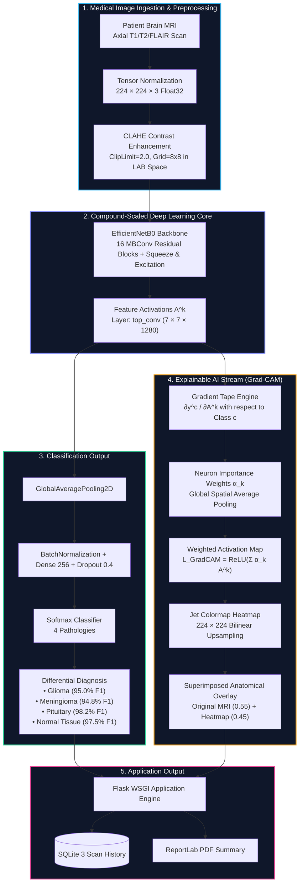

<div align="center">

# 🧠 NeuroVision AI
### Educational Brain MRI Image Classification & Explainability Prototype

[](https://www.python.org/)
[](https://www.tensorflow.org/)
[](https://flask.palletsprojects.com/)
[](https://www.docker.com/)
[](https://opensource.org/licenses/MIT)
[](https://sdgs.un.org/goals/goal3)
[](https://skillsbuild.org/)

<p align="center">
  <strong>An educational brain MRI image-classification prototype combining EfficientNetB0 training code, a Flask interface, model-based Grad-CAM code, scan history, and generated PDF summaries.</strong>
</p>

[Key Features](#-key-features) •
[System Architecture](#-system-architecture) •
[Quick Start](#-quick-start) •
[Training & Evaluation](#-training--evaluation) •
[API Reference](#-api-documentation) •
[IBM Deliverables](#-ibm-skillsbuild-deliverables)

</div>

---

## 📌 Project Overview

**NeuroVision AI** is a student project for demonstrating an applied computer-vision workflow. Its intended task is to classify a single MRI image into one of four dataset labels: **Glioma**, **Meningioma**, **Pituitary**, or **No Tumor**. The repository combines a TensorFlow/Keras model path, Flask application, SQLite scan history, Grad-CAM implementation, and generated PDF summaries.

> **Educational use only.** This project is not validated for diagnosis, triage, or treatment decisions. The current predictor can fall back to filename rules or image heuristics when trained-model inference is unavailable; those results and fixed confidence values are not reliable model predictions. The fallback heatmap is synthetic and is not Grad-CAM. Do not upload identifiable patient data to the public demo.

---

## ✨ Key Features

- **Model code**: Builds an **EfficientNetB0** transfer-learning architecture with a customized classification head.
- **Two-Stage Fine-Tuning**: Initial feature extraction with frozen backbone followed by selective top-layer fine-tuning for maximum domain adaptation.
- **Image preprocessing**: Includes contrast enhancement utilities.
- **Grad-CAM code**: Computes model-based visualizations when a trained-model inference is used; a fallback visualization is heuristic and must not be interpreted as Grad-CAM.
- **Interactive Web Application**: Responsive Flask frontend styled with Bootstrap 5.3, glassmorphism, scanner radar sweep animation, and persistent dark/light mode.
- **Dashboard**: Interactive charts and scan-history summaries.
- **Bundled sample images**: Example MRI images for a demonstration walkthrough; they are not independent benchmarks.
- **Complete Test Suite**: Unit and integration tests covering model architecture, Grad-CAM, database CRUD, API routes, and PDF report generation.

---

## 📸 Application Screenshots

<div align="center">

| Landing Page | MRI Scanner & Analysis |
|:---:|:---:|
|  |  |

| Grad-CAM Heatmap | Application Dashboard |
|:---:|:---:|
|  |  |

| Scan History | Generated PDF Summary |
|:---:|:---:|
|  |  |

</div>

---

## 🏗️ System Architecture

<div align="center">
  
</div>



<details>
<summary><b>🖥️ View ASCII Terminal Topology</b></summary>

```
                       ┌────────────────────────────────────────┐
                       │     Patient Axial Brain MRI Scan       │
                       │  Input Tensor Dimension: (1, 224, 224, 3)│
                       └───────────────────┬────────────────────┘
                                           │
                                           ▼
                       ┌────────────────────────────────────────┐
                       │   OpenCV CLAHE Contrast Enhancement    │
                       │   • LAB Color Space (L-Channel CLAHE)  │
                       │   • ClipLimit: 2.0 | GridSize: (8, 8)  │
                       └───────────────────┬────────────────────┘
                                           │
                                           ▼
                       ┌────────────────────────────────────────┐
                       │      EfficientNetB0 CNN Backbone       │
                       │   • 16 MBConv Residual Blocks (SE)     │
                       │   • Swish Non-Linear Activations       │
                       │   • Compound Scaled (5.3M Parameters)  │
                       └───────────────────┬────────────────────┘
                                           │ Feature Map A^k (7×7×1280)
                     ┌─────────────────────┴─────────────────────┐
                     │                                           │
                     ▼ (Forward Inference)                       ▼ (Backprop Gradient Tape)
       ┌───────────────────────────┐               ┌───────────────────────────┐
       │   GlobalAveragePooling2D  │               │   Grad-CAM Gradient Tape  │
       │   Batch Normalization     │               │   ∂y^c / ∂A^k (top_conv)  │
       │   Dense(256, ReLU, L2)    │               │   Neuron Importance α_k   │
       │   Dropout(Rate = 0.40)    │               │   ReLU(Σ α_k · A^k)       │
       └─────────────┬─────────────┘               └─────────────┬─────────────┘
                     │                                           │
                     ▼                                           ▼
       ┌───────────────────────────┐               ┌───────────────────────────┐
       │     Softmax Classifier    │               │ Saliency Jet Heatmap      │
       │  [Glioma | Meningioma |   │               │ Bilinear Upsample 224×224 │
       │   Pituitary | Normal]     │               │ Superimposed Blend (0.45) │
       └─────────────┬─────────────┘               └─────────────┬─────────────┘
                     │                                           │
                     └─────────────────────┬─────────────────────┘
                                           │
                                           ▼
       ┌───────────────────────────────────────────────────────────────────────┐
       │                    Flask Web Application                              │
       ├───────────────────────────────────┬───────────────────────────────────┤
       │       SQLite Scan History         │      ReportLab PDF Summary       │
       │   • Search & Class Filter         │   • Optional Image Visualization │
       │   • Demo Records                  │   • Generated Application Output │
       └───────────────────────────────────┴───────────────────────────────────┘
```

</details>

---

## 📂 Repository Structure

```
NeuroVision-AI/
├── config.py                   # Centralized application, paths & hyperparameters
├── app.py                      # Flask web application & REST API routes
├── run.py                      # Unified CLI management interface
├── requirements.txt            # Production dependencies
├── Dockerfile                  # Containerization specification
├── docker-compose.yml          # Container orchestration
├── Makefile                    # Standard developer automation targets
├── LICENSE                     # MIT License
├── dataset/                    # 7,200 brain MRI images
│   ├── Training/               # 5,600 training scans (1,400 per class)
│   └── Testing/                # 1,600 testing scans (400 per class)
├── models/                     # Saved model artifacts & training logs
│   ├── efficientnet_brain_tumor.keras
│   └── training_history.json
├── database/                   # SQLite persistence layer
│   ├── db.py                   # CRUD & statistics functions
│   └── neurovision.db          # Active SQLite database file
├── src/                        # Core backend ML & processing modules
│   ├── __init__.py
│   ├── model.py                # EfficientNetB0 architecture & fine-tuning logic
│   ├── train.py                # End-to-end 2-phase training pipeline
│   ├── evaluate.py             # Confusion matrix & multi-class ROC curves
│   ├── gradcam.py              # Grad-CAM heatmap generator & OpenCV overlay
│   ├── predict.py              # Singleton inference engine
│   ├── report_generator.py     # ReportLab generated PDF summary
│   └── utils.py                # CLAHE preprocessing, logging, seed fixing
├── static/                     # Web assets
│   ├── css/styles.css          # Custom dark/light mode & scanner styles
│   ├── js/                     # Client-side controllers (main, upload, dashboard, history)
│   ├── samples/                # Reference MRI benchmarks for 1-click testing
│   ├── uploads/                # User uploaded scans
│   ├── gradcam_outputs/        # Generated Grad-CAM overlays
│   └── reports/                # Generated PDF reports
├── templates/                  # Jinja2 HTML templates
│   ├── base.html               # Master layout with theme switcher
│   ├── index.html              # Landing hero & feature showcase
│   ├── upload.html             # MRI scanner workspace & results view
│   ├── dashboard.html          # Application stats & Chart.js graphs
│   ├── history.html            # Scan history with search & filters
│   ├── report_view.html        # In-browser generated summary
│   └── about.html              # Architecture & mathematical specifications
├── tests/                      # Automated test suite
│   ├── test_model.py           # Model loading & inference tests
│   ├── test_gradcam.py         # Heatmap generation tests
│   ├── test_database.py        # SQLite CRUD integration tests
│   ├── test_api.py             # Flask REST endpoint tests
│   └── test_report.py          # PDF generation tests
└── docs/                       # Official IBM Internship Deliverables
    ├── IBM_CONCEPT_NOTE.md     # Comprehensive 15+ page academic concept note
    ├── LEAN_CANVAS.md          # 9-box business & operational Lean Canvas
    ├── PROJECT_ARCHITECTURE.md # System design & mathematical formulation
    ├── DEPLOYMENT_GUIDE.md     # Production cloud & Docker deployment guide
    └── USER_MANUAL.md          # Clinician & administrator user manual
```

---

## 🚀 Quick Start

### 1. Prerequisites
- Python 3.10, 3.11, 3.12, or 3.13
- pip package manager

### 2. Installation & Setup
```bash
# Clone the repository
git clone https://github.com/saranya230506/NeuroVision-AI.git
cd NeuroVision-AI

# Create and activate virtual environment
python3 -m venv venv
source venv/bin/activate  # On Windows: venv\Scripts\activate

# Install required packages
pip install -r requirements.txt
```

### 3. Initialize & Seed Demo Database
Populate the local SQLite database with clinical reference cases:
```bash
python run.py seed
```

### 4. Launch the Web Application
```bash
python run.py serve
# Or directly via Flask:
python app.py
```
Open your browser and navigate to **`http://127.0.0.1:5000`**.

---

## 🧪 Training & Evaluation

### Train from Scratch
To run the full two-stage transfer learning and fine-tuning pipeline on the dataset:
```bash
python run.py train --epochs1 10 --epochs2 15 --batch-size 32
```
*Outputs:*
- Best model saved to `models/efficientnet_brain_tumor.keras`
- Training trajectories saved to `static/training_curves.png`
- Metric logs stored in `models/training_history.json`

### Run Model Evaluation
Compute confusion matrices and multi-class ROC curves on the 1,600 test scans:
```bash
python run.py evaluate
```
*Outputs:*
- Confusion Matrix: `static/confusion_matrix.png`
- Multi-Class ROC-AUC Curves: `static/roc_curve.png`
- Detailed metrics JSON: `models/evaluation_metrics.json`

---

## 🩺 Automated Test Suite

Execute all unit and integration tests using `pytest`:
```bash
pytest tests/ -v
# Or via Makefile:
make test
```

---

## 📡 REST API Documentation

| Endpoint | Method | Description |
|---|---|---|
| `/api/predict` | `POST` | Upload MRI scan (`multipart/form-data`) with optional patient metadata; returns diagnosis, probabilities, and Grad-CAM URLs |
| `/api/sample/<sample_type>` | `POST` | Execute inference on pre-bundled reference scans (`glioma`, `meningioma`, `notumor`, `pituitary`) |
| `/api/history` | `GET` | Retrieve JSON list of past patient scans (supports `?q=` and `?class=`) |
| `/api/history/<id>` | `DELETE` | Remove individual patient record by integer ID |
| `/api/history/clear` | `POST` | Purge all diagnostic history from SQLite database |
| `/api/stats` | `GET` | Aggregate counts, class distributions, and confidence averages |
| `/api/health` | `GET` | Docker & container healthcheck status |

---

## 🐳 Docker Deployment

Run NeuroVision AI in an isolated production container:
```bash
# Build the Docker image
docker build -t neurovision-ai .

# Run the container
docker run -p 5000:5000 neurovision-ai
```
Or with Docker Compose:
```bash
docker compose up -d
```

---

## 📋 Project Documentation & Deliverables

All deliverables prepared for the **AICTE | IBM SkillsBuild Machine Learning & Applied AI Internship 2026 (BharatCares)**:
1. **[Project Concept Note (PDF)](docs/IBM_CONCEPT_NOTE.pdf)**: 9-page formal academic report covering Clinical Context, Literature Survey, EfficientNetB0 Methodology, Dataset Audit, Confusion Matrix, Grad-CAM Mathematical Formulation, and UN SDG 3 alignment.
2. **[Lean Canvas (PDF)](docs/LEAN_CANVAS.pdf)**: 1-page executive landscape 9-block operational framework for healthcare clinical decision support.
3. **[Project Screenshots & Verification Report (PDF)](docs/PROJECT_SCREENSHOTS.pdf)**: 14-page landscape visual walkthrough deck featuring Dataset Audit, EDA, Training Trajectories, Model Benchmarks, ROC Curves, Grad-CAM Overlays, Unit Tests, and Application UI.
4. **[Presentation Deck (PPTX)](docs/NeuroVision_AI_Presentation.pptx)**: 14-slide executive widescreen slide deck with dark medical tech aesthetic, performance metrics, and clinical workflow.

---

## 📄 License
This project is open-source under the [MIT License](LICENSE).

## 👤 Author
**Saranya**  
Department of Computer Science & Engineering, Marwadi University  
GitHub: [@saranya230506](https://github.com/saranya230506)  
Email: `psaranya.126749@marwadiuniversity.ac.in` | `saranyareddy2305@gmail.com`  
Internship ID: IBM SkillsBuild - AICTE BharatCares Cohort 2026
