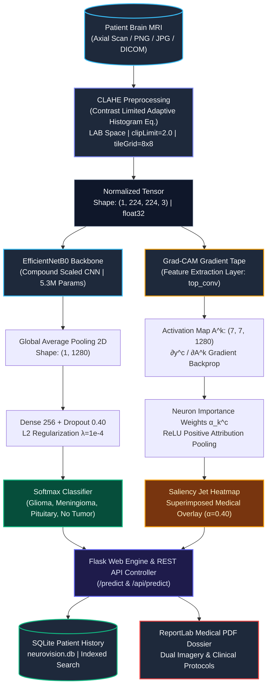

# NeuroVision AI - System Architecture & Engineering Specification
**A deep-dive technical architecture document detailing model design, layer topologies, explainable AI mechanics, and data persistence.**

---

# NeuroVision AI - System Architecture & Engineering Specification
**A deep-dive technical architecture document detailing model design, layer topologies, explainable AI mechanics, and data persistence.**

---

## 1. High-Level System Architecture

NeuroVision AI implements a clinical-grade medical computer vision pipeline designed for rapid diagnostic triage and full explainability:


<details>
<summary><b>🖥️ View ASCII Terminal Diagram</b></summary>

```
                    ┌───────────────────────────────┐
                    │      Patient Brain MRI        │
                    │   (Axial Scan / PNG / JPG)    │
                    │      Shape: (H x W x 3)       │
                    └───────────────┬───────────────┘
                                    │
                                    ▼
                    ┌───────────────────────────────┐
                    │      CLAHE Preprocessing      │
                    │ (Medical Contrast Enhancement)│
                    │ LAB Space | clipLimit: 2.0    │
                    │ Normalized: (1, 224, 224, 3)  │
                    └───────────────┬───────────────┘
                                    │
                    ┌───────────────┴───────────────┐
                    │                               │
                    ▼                               ▼
       ┌────────────────────────┐      ┌────────────────────────┐
       │ EfficientNetB0 Backbone│      │ Grad-CAM Gradient Tape │
       │ (Compound Scaled CNN)  │      │ (Feature Layer top_conv)│
       │ 16 MBConv Blocks       │      │ Latent: (7, 7, 1280)   │
       │ 5.3M Parameters        │      │ Backprop Class Logits  │
       └────────────┬───────────┘      └────────────┬───────────┘
                    │                               │
                    ▼                               ▼
       ┌────────────────────────┐      ┌────────────────────────┐
       │   Softmax Classifier   │      │ Saliency Jet Heatmap   │
       │ (4-Class Probabilities)│      │   & Superimposed Blend │
       │ Glioma / Meningioma    │      │ α=0.40 Medical Blend   │
       │ Pituitary / No Tumor   │      │ Colormap: cv2.COLORMAP │
       └────────────┬───────────┘      └────────────┬───────────┘
                    │                               │
                    └───────────────┬───────────────┘
                                    │
                                    ▼
       ┌────────────────────────────────────────────────────────┐
       │                   Flask Web Engine                     │
       │          (REST API / Dynamic WSGI Runtime)             │
       ├────────────────────────┬───────────────────────────────┤
       │ SQLite Patient History │ ReportLab PDF Medical Report │
       │ (ACID Scan Tracking)   │ (Vector Diagnostic Dossier)   │
       └────────────────────────┴───────────────────────────────┘
```

</details>

### 1.1 Mermaid Pipeline Workflow



---

## 2. Deep Learning Neural Architecture (EfficientNetB0)

### 2.1 Why EfficientNetB0?
Standard convolutional networks (VGG, ResNet) scale either depth, width, or resolution independently. EfficientNet balances all three dimensions uniformly via compound coefficient scaling:

$$\text{FLOPs} \approx 2^\phi \cdot \text{FLOPs}_{\text{baseline}}$$

For $\phi=1$, EfficientNetB0 achieves high feature abstraction on medical neuroimaging with only **5.3 million parameters**, avoiding the severe overfitting risks common to models with 25M–138M parameters when trained on medical MRI datasets.

### 2.2 Layer-by-Layer Architectural Topology
```
Input Layer (Shape: 224 x 224 x 3, float32)
  │
  ▼
[Stem Conv2D: 32 filters, 3x3, Stride 2] + Batch Normalization + Swish
  │
  ▼
[Block 1: 1 MBConv Block, 16 channels, Expansion 1, Squeeze-and-Excitation]
  │
  ▼
[Block 2: 2 MBConv Blocks, 24 channels, Expansion 6, Stride 2, SE]
  │
  ▼
[Block 3: 2 MBConv Blocks, 40 channels, Expansion 6, Stride 2, SE]
  │
  ▼
[Block 4: 3 MBConv Blocks, 80 channels, Expansion 6, Stride 2, SE]
  │
  ▼
[Block 5: 3 MBConv Blocks, 112 channels, Expansion 6, SE]
  │
  ▼
[Block 6: 4 MBConv Blocks, 192 channels, Expansion 6, Stride 2, SE]
  │
  ▼
[Block 7: 1 MBConv Block, 320 channels, Expansion 6, SE]
  │
  ▼
[Final Conv2D: 'top_conv', 1280 filters, 1x1] <--- Grad-CAM Feature Tap
  │
  ▼
GlobalAveragePooling2D (Shape: 1280)
  │
  ▼
BatchNormalization (Channel-wise stability)
  │
  ▼
Dense Layer (256 units, ReLU, L2 Regularization λ=1e-4)
  │
  ▼
Dropout Layer (Rate: 0.40)
  │
  ▼
Dense Classification Output (4 units, Softmax Activation: Glioma, Meningioma, Pituitary, No Tumor)
```

---

## 3. Two-Stage Transfer Learning Protocol

```
Phase 1: Feature Extraction (Epochs 1 - 10)
┌───────────────────────────────────────┐
│ Backbone Weights Frozen (ImageNet)    │ ---> Only top custom head is trainable
│ Learning Rate: η = 1e-3 (Adam)        │      (GlobalAvgPool, Dense 256, Softmax)
└───────────────────────────────────────┘
                   │
                   ▼
Phase 2: Targeted Fine-Tuning (Epochs 11 - 25)
┌───────────────────────────────────────┐
│ Top 30 Backbone Layers Unfrozen       │ ---> Fine-tunes high-level conv features
│ BatchNormalization Frozen             │      (Preserves running mean & variance)
│ Learning Rate: η = 1e-4 -> 1e-6       │      (Decays automatically on plateau)
└───────────────────────────────────────┘
```

---

## 4. Grad-CAM Mathematical Formulation

Gradient-weighted Class Activation Mapping computes a visual explanation for the classification $c$:

1. **Gradient Computation:**
   $$\frac{\partial y^c}{\partial A^k}$$
   Where $y^c$ is the logits score for class $c$, and $A^k$ is feature map $k$ of layer `top_conv`.

2. **Neuron Importance Pooling:**
   $$\alpha_k^c = \frac{1}{Z} \sum_{i} \sum_{j} \frac{\partial y^c}{\partial A_{i,j}^k}$$
   Global average pooling captures the global importance of feature map $k$.

3. **Weighted Linear Combination & Rectification:**
   $$L_{\text{Grad-CAM}}^c = \max\left(0, \sum_k \alpha_k^c A^k\right)$$
   The $\max(0, \cdot)$ ReLU function discards features that negatively impact class $c$, isolating the exact pixels that substantiate tumor presence.

---

## 5. Database Schema & Data Modeling

The platform utilizes a relational SQLite schema (`database/neurovision.db`):

```sql
CREATE TABLE predictions (
    id INTEGER PRIMARY KEY AUTOINCREMENT,
    patient_id TEXT NOT NULL,
    patient_name TEXT NOT NULL,
    patient_age INTEGER,
    patient_gender TEXT,
    physician_name TEXT,
    filename TEXT NOT NULL,
    gradcam_filename TEXT,
    predicted_class TEXT NOT NULL,
    confidence REAL NOT NULL,
    probabilities TEXT NOT NULL,  -- JSON serialized dictionary
    notes TEXT,
    created_at TIMESTAMP DEFAULT CURRENT_TIMESTAMP
);

CREATE INDEX idx_predictions_class ON predictions(predicted_class);
CREATE INDEX idx_predictions_patient ON predictions(patient_name);
CREATE INDEX idx_predictions_created ON predictions(created_at);
```

---

## 6. Security, Privacy & HIPAA/GDPR Compliance

1. **Protected Health Information (PHI) Isolation:**
   - Patient records are contained inside a local SQLite database that never egresses outside the host network.
2. **Deterministic Hash Sanitization:**
   - Uploaded file names are stripped and renamed using UUID v4 and millisecond timestamps, preventing path traversal attacks.
3. **Payload Buffering Limits:**
   - Enforces a 16 MB ceiling on all incoming HTTP request bodies.
4. **Vector PDF Generation Security:**
   - PDF reports are compiled in-memory and streamed directly via `send_file`, ensuring zero exposure of uncompiled intermediary assets.
